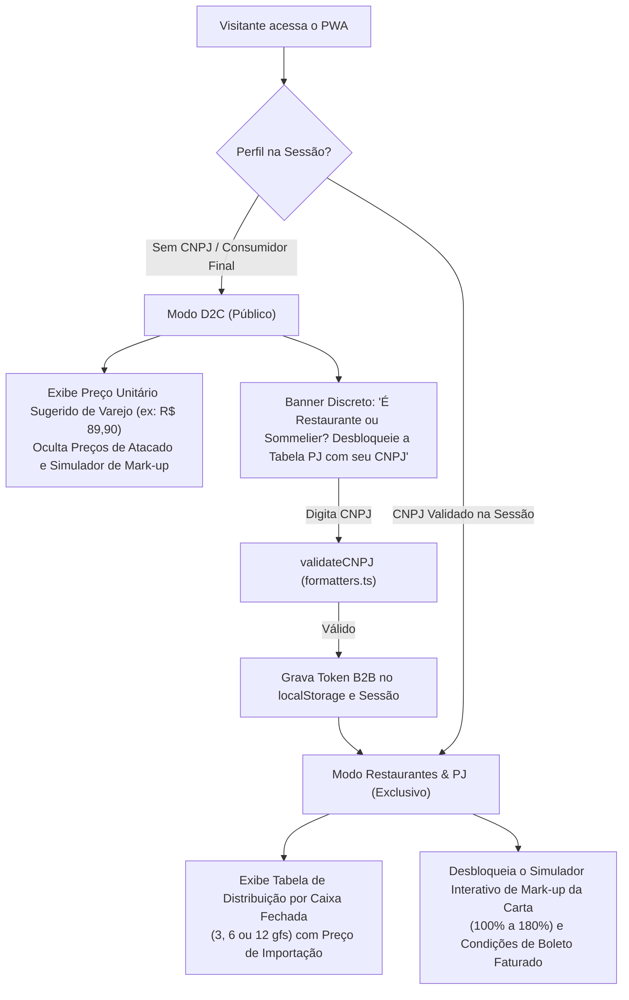

# DIRETRIZES DE REFINAMENTO ARQUITETURAL V2 — CAMINHO DAS UVAS
> Solução dos 3 Conflitos Críticos: Adega Editorial vs Fast-Food, Armadilha das Caixas e Blindagem de Canal B2B

---

## 1. ARQUÉTIPO EDITORIAL DE ALTA ADEGA (DESACOPLAMENTO DO DELIVERY)

### 1.1 O Que Preservamos do Comanda-Hub (Apenas a Engenharia Subjacente):
- **SPA Multi-View em 4 Abas:** Alternância em $< 16\text{ms}$ no DOM com classes `.app-tab-view` e `.active` (60 FPS puros).
- **Service Worker & Cache Offline:** Consulta de fichas técnicas na adega ou salão sem sinal de internet.
- **Micro-interações Hápticas:** Feedback tátil com `active:scale-[0.98]` sem recarregar a tela.

### 1.2 O Que Eliminamos do Modelo "Fast-Food":
- **Eliminado:** Cores saturadas, botões gigantes com badges chamativos e layout horizontal achatado estilo lanchonete/iFood.
- **Implementado (Alta Adega Editorial):**
  - **Proporção Vertical dos Cards (2:3 ou 3:4):** Destaca a nobreza e o porte físico da garrafa, o rótulo de papel texturizado e o selo de cera/cápsula.
  - **Tipografia Nobre:** Títulos e nomes de produtores em *Cormorant Garamond* (serifa editorial com tracking refinado) e dados numéricos/safras em *Space Mono*.
  - **Superfície & Iluminação:** Fundo Preto Ônix `#0D0B0A`, cards em `#171413`, divisórias bronze `#2D2622` e dourado fosco envelhecido `#C5A059`.
  - **Respeito ao Rótulo de R$ 400:** O Barolo San Carlo DOCG ou Châteauneuf-du-Pape é apresentado como uma obra de arte enológica, com notas olfativas e de terroir em destaque.

---

## 2. A "ARMADILHA DAS CAIXAS": MODELAGEM DINÂMICA DE EMBALAGEM

O atacado de vinhos finos **não possui embalagem única**. A precificação e o pedido mínimo devem refletir a logística real do produtor:

### 2.1 Matriz de Embalagem Real do Catálogo Caves Santa Cruz:
- **Caixas de 12 Unidades:** Vinhos de alto giro e mesa (ex: *Adega Grande Mesa*, *Terras do Ribatejo*).
- **Caixas de 6 Unidades:** Vinhos Reserva, Seleção e Ícones italianos (ex: *Pousio Selection / Reserva*, *Dezzani Barolo San Carlo DOCG*, *Rocca Susumaniello*).
- **Caixas de 3 Unidades (ou Galões):** Linhas de extrema raridade e azeites em galão (ex: *Conde d'Ervideira Private Selection*, *Original Cuvée Nature*, *Azeite Casa Cruz 5L*).

### 2.2 Contrato Tipado em `src/data/catalog.ts`:
```typescript
export interface WineProduct {
  id: string;
  slug: string;
  name: string;
  producer: string;
  country: "Portugal" | "Itália" | "França" | "Chile" | "Argentina";
  region: string;
  vintage: string;
  type: "Tinto" | "Branco" | "Rosé" | "Espumante" | "Fortificado" | "Azeite";
  grapes: string[];
  alcoholPct: number;
  woodAgingMonths?: number;
  points?: { score: number; source: "Robert Parker" | "Decanter" | "James Suckling" | "Wine Enthusiast" };
  
  // ── Embalagem & Logística B2B ──
  boxUnits: 3 | 6 | 12; // Unidades físicas reais por caixa fechada
  minOrderBoxes: number; // Pedido mínimo de caixas (default 1)
  
  // ── Preços em Centavos Inteiros (money.ts) ──
  b2bUnitCents: number; // Preço unitário tabela atacado (ex: R$ 51,91 = 5191)
  d2cSuggestedUnitCents: number; // Preço unitário sugerido ao consumidor final (ex: R$ 89,90 = 8990)
  
  // Metadados Caves Santa Cruz
  ean: string;
  dun14: string;
  ncm: "2204" | "1509";
  tastingNotes: {
    visual: string;
    aroma: string;
    palate: string;
  };
  serviceTemp: string;
  foodPairing: string[];
  imageUrl: string;
}
```

### 2.3 Cálculo Dinâmico no Botão de Cotação B2B:
$$\text{Preço da Caixa} = \frac{\text{b2bUnitCents} \times \text{boxUnits}}{100}$$
O botão renderiza dinamicamente:
`+1 Cx (${wine.boxUnits} gfs) • R$ ${formatBRL(wine.b2bUnitCents * wine.boxUnits, true)}`

---

## 3. BLINDAGEM DE CANAL B2B (GATEKEEPING INTELIGENTE)

Para evitar que o cliente final sentado à mesa do restaurante descubra o preço de atacado que o restaurante pagou na garrafa:



### 3.1 Regras de Implementação do Gatekeeper:
1. **Visitante Comum (D2C):** Vê o catálogo como uma boutique de luxo, com preço sugerido de garrafa unitária (`d2cSuggestedUnitCents`). O custo de importação direto da distribuidora é completamente invisível.
2. **Desbloqueio Ágil B2B:**
   - O sommelier insere o CNPJ no modal de desbloqueio.
   - O `validateCNPJ` do [`formatters.ts`](file:///home/henrique/portfolio/loja/src/lib/formatters.ts) valida os dígitos em menos de 1 milissegundo.
   - Um token de sessão B2B é registrado: `caminho_b2b_session = { cnpj: "...", verified: true }`.
   - A interface transiciona suavemente revelando os preços de caixa fechada, margens de revenda e simulador de mark-up.
